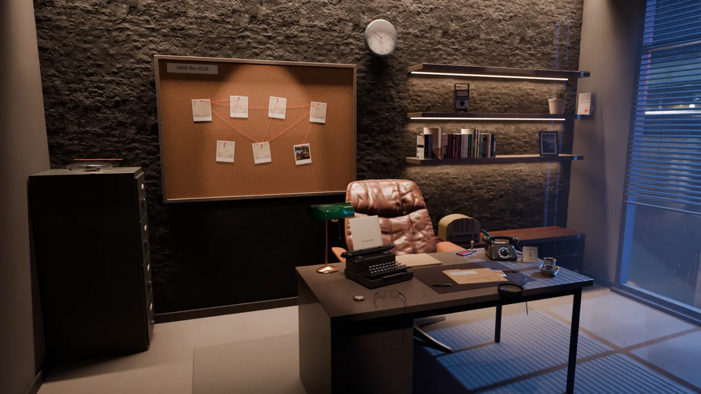

# The Case File

So this is my portfolio. I got bored of the usual "photo + skills + 3 project cards" thing, so I made mine a crime scene instead. You're the detective, I'm the suspect, and my projects are the evidence.

Check it out here 👉 [ayaanbagawan.in](https://ayaanbagawan.in)



## What you'll see

You start in a dark corridor outside a door with my name on it. Scroll and the door opens into an old detective's office at night. There's rain on the window, a typewriter on the desk, and your mouse works as a flashlight.

Keep scrolling and you go through the whole case:

- a folder on the desk with my details
- an evidence board with a photo for every project, connected with red string
- an evidence table with my tools sealed in evidence bags
- an interrogation room where I answer a few questions
- the verdict (spoiler: guilty)
- and at the end the phone rings. pick it up if you want to leave me a message

If you open it on a phone or an older laptop you get a lighter version. Same case file, just laid out on paper without the 3D, so it loads fast anywhere.

## How I made it

I built and lit every room myself in Blender. The rooms are made with Python scripts (they're in `blender/`) so I can rebuild everything from scratch whenever I change something. The lighting gets baked in Blender and then the browser adds the stuff that moves, like the flashlight, the rain, the dust and the flickering bulb.

The website side is Next.js and React, with Three.js (through React Three Fiber) for the 3D, and GSAP + Lenis for the scrolling. It's hosted on Cloudflare Pages, and the contact form runs on a small Cloudflare function.

Honestly some parts of the code were vibe coded, I used AI tools to get through those faster. But the idea, the story, the design and all the Blender work is mine. It took me about a month and a half, and most of that time went into making it look like a real room at night and then making it actually run smoothly.

## Running it locally

You'll need Node 24, pnpm and Git LFS (the 3D models and sounds are stored with LFS).

```bash
git lfs install
git clone https://github.com/Ayaan2316/the-case-file.git
cd the-case-file
pnpm install
pnpm dev
```

Then go to http://localhost:3000.

`pnpm build` gives you the static site in `out/`. If you want to rebuild the 3D rooms you'll also need Blender 5.1, my notes for that are in `docs/DEVELOPMENT.md`.

## Where stuff is

- `content/case.ts` has all the text on the site (projects, skills, the interrogation answers)
- `components/canvas/` is the 3D part
- `components/lite/` is the lighter no-3D version
- `blender/` has the scripts that build, light and export each room
- `functions/` is the contact form backend

## Credits

All the textures, models, fonts and sounds I used are free (mostly CC0). Everything's listed with the author and licence in [CREDITS.md](CREDITS.md).

Made by Ayaan Bagawan, 2026
